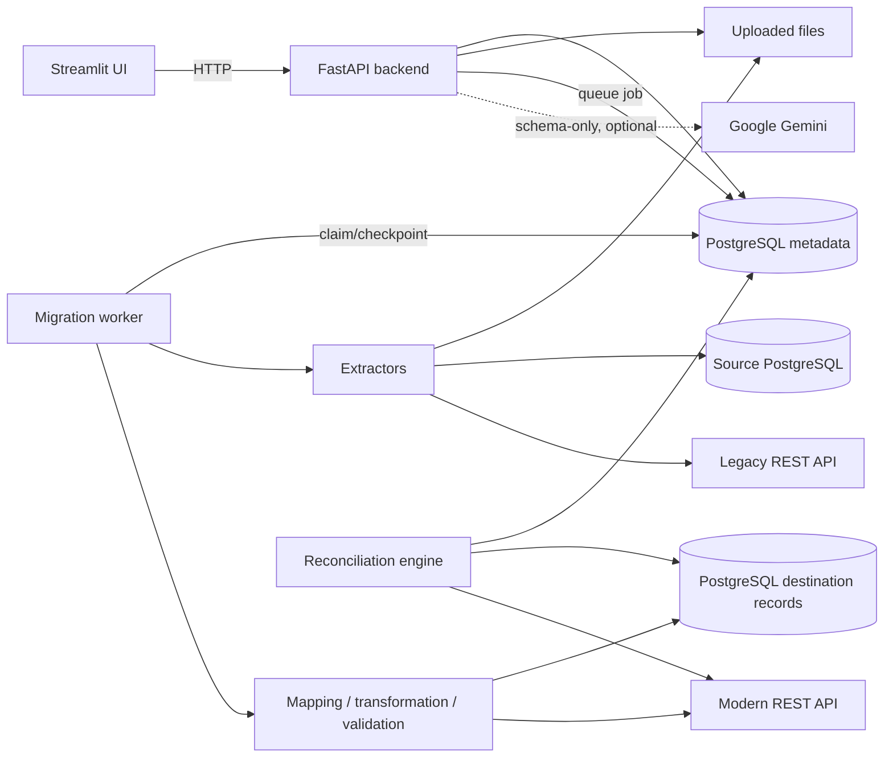

# MigrateIQ AI

MigrateIQ AI is a working data migration and reconciliation platform for moving customer data from legacy files, PostgreSQL databases, and REST APIs into PostgreSQL or a modern SaaS API. It combines a durable ETL worker, explicit transformation rules, row-level auditability, idempotent loading, and post-migration verification with optional Gemini assistance.

The ordinary migration path does not require an AI key. Gemini can suggest schema mappings and safe cleaning rules and can explain validation failures; validated Python code—not the model—performs every data change.

## Why this project exists

Migration projects fail when mapping decisions, rejected records, retry behavior, and verification are hidden behind a single “success” total. MigrateIQ treats those concerns as first-class data. Every job records its checkpoint and distinguishes inserted, updated, skipped, and rejected rows. Reconciliation compares the transformed source representation with the destination by business key and normalized checksum, then identifies missing keys and field-level differences.

## Features

- CSV, XLSX, JSON, XML, PostgreSQL, and paginated REST sources
- PostgreSQL and REST API destinations
- Source inspection with detected columns, types, counts, nulls, and duplicates
- Deterministic schema matching plus optional Gemini structured suggestions
- Safe registry of trim, case, date, type, null, email, phone, rename, combine, split, default, and deduplication operations
- Before/after transformation and validation previews
- Database-backed worker with durable checkpoints and batch commits
- Idempotent PostgreSQL upserts and REST create-or-update behavior
- Row-level results, validation messages, audit logs, resumable failed jobs, and rejected-record export
- Count, key, duplicate, checksum, and field-level reconciliation
- JSON migration summary and rejected CSV downloads
- Synthetic 10,000-record generator with intentional migration defects
- Self-contained authenticated LegacyCRM and ModernCRM demonstration API
- Streamlit operator interface backed exclusively by real FastAPI calls

## Architecture



The API request that starts a migration only persists a queued job. A separate worker atomically claims that job, extracts and transforms the source, commits each batch with its checkpoint, and records per-row outcomes. HTTP requests never remain open for the duration of a migration.

## Quick start with Docker (Windows 11)

Prerequisites: Docker Desktop with the Linux container engine running.

```powershell
Copy-Item .env.example .env
docker compose up --build -d
docker compose ps
```

Open:

- UI: <http://localhost:8501>
- MigrateIQ API documentation: <http://localhost:8000/docs>
- Demo CRM API documentation: <http://localhost:8001/docs>
- PostgreSQL: `localhost:55432` (container port `5432`)

Stop the stack without deleting PostgreSQL data:

```powershell
docker compose down
```

The included `scripts/start-local.ps1` performs the copy/start operation as a convenience.

## Local Python workflow

Python 3.12+ and PostgreSQL 16+ are recommended.

```powershell
py -3.12 -m venv .venv
.\.venv\Scripts\Activate.ps1
python -m pip install -e ".[dev]"
Copy-Item .env.example .env
# Edit DATABASE_URL in .env for the local PostgreSQL instance.
alembic upgrade head
```

Run these commands in separate PowerShell windows:

```powershell
uvicorn migrateiq.api:app --reload --port 8000
migrateiq-worker
uvicorn migrateiq.demo_crm:app --reload --port 8001
$env:API_BASE_URL="http://localhost:8000"; streamlit run frontend/app.py
```

For the local demo CRM only, set `ALLOW_PRIVATE_NETWORKS=true`. Leave it false when users can enter untrusted URLs; the default blocks loopback, private, and link-local REST targets.

## Demo data

Generate the repeatable 10,000-row dataset:

```powershell
migrateiq-seed --count 10000 --output demo_data/customers_10000.csv
```

Add `--register` to create a source connection, PostgreSQL destination, and migration project in the configured metadata database. All names, emails, phones, defects, and identifiers are synthetic. The generator introduces duplicate IDs, missing emails, malformed emails and phones, inconsistent dates, nulls, unexpected columns, and a missing final identifier.

A six-row quick sample is committed at `demo_data/sample_customers.csv`.

## Demonstration workflows

### A. CSV to PostgreSQL

1. Open **Data Sources**, upload the sample CSV, and inspect its real schema and issues.
2. Add a PostgreSQL destination and create a project with `customer_id` as its business key.
3. Generate mappings for `cust_id → customer_id`, `cust_name → full_name`, `mobile_no → phone`, `email_id → email`, and `join_date → created_at`.
4. Approve mappings, configure transformations, and add required/email/date validation rules.
5. Preview the transformation and validation results.
6. Queue the job on **Execution** and refresh while the worker commits batches.
7. Run reconciliation and download the JSON and rejected CSV reports.
8. Run a second job; unchanged destination rows are skipped rather than duplicated.

PostgreSQL-loaded records are queryable in `destination_records`; the normalized destination payload is stored in its `data` JSON column and is uniquely constrained by `(project_id, business_key)`.

### B. LegacyCRM to ModernCRM

Create a REST source with:

```json
{
  "url": "http://demo-crm:8001/legacy/customers",
  "headers": {"X-API-Key": "demo-secret"},
  "items_path": "items",
  "pagination": "page",
  "page_size": 100
}
```

Create a REST destination with:

```json
{
  "url": "http://demo-crm:8001/modern/customers",
  "list_url": "http://demo-crm:8001/modern/customers",
  "headers": {"X-API-Key": "demo-secret"},
  "items_path": "items",
  "upsert": true
}
```

Map the two different CRM schemas, normalize names/phones/dates, run the job, and reconcile it. Authentication failures return 401, duplicate creates return 409, invalid records return 422, and an optional `simulate_rate_limit` query value exercises a one-time 429 response.

## API overview

| Area | Important endpoints |
|---|---|
| Health and metrics | `GET /health`, `GET /api/dashboard` |
| Sources | `POST /api/sources/upload`, `GET /api/sources/{id}/preview` |
| Projects | `POST/GET /api/projects`, `PATCH/DELETE /api/projects/{id}` |
| Mapping | `POST /api/mappings/suggest`, `PUT/GET /api/projects/{id}/mapping` |
| Preview | `POST /api/transformations/preview`, `POST /api/validations/preview` |
| AI assistance | `GET /api/projects/{id}/cleaning-suggestions`, `POST /api/ai/explain-validation` |
| Jobs | `POST/GET /api/jobs`, `GET /api/jobs/{id}`, `POST /api/jobs/{id}/retry` |
| Results | `GET /api/jobs/{id}/records`, `GET /api/jobs/{id}/logs` |
| Reconciliation | `POST /api/jobs/{id}/reconcile`, `GET /api/jobs/{id}/reconciliation` |
| Reports | `GET /api/jobs/{id}/report.json`, `GET /api/jobs/{id}/rejected.csv` |

Interactive request/response schemas are available from FastAPI at `/docs`.

## Reliability and security model

- A batch and its destination rows, row outcomes, counters, and checkpoint commit in one PostgreSQL transaction.
- File sources are safely replayed on resume; processing restarts at the committed transformed-row checkpoint, and destination business-key upserts prevent duplicates.
- REST retries use bounded exponential backoff for transient extraction failures and honor `Retry-After` on 429 responses.
- PostgreSQL source SQL accepts one `SELECT`/`WITH` statement and opens a read-only transaction.
- External REST URLs reject non-HTTP schemes and private network ranges unless explicitly enabled.
- XML uses `defusedxml`; uploads enforce extension and size limits.
- Configuration values are parameterized, API credentials are redacted from responses, and logs never include connection configuration or record values.
- Gemini receives field/schema metadata and validation messages by default, not customer sample values. Structured responses are validated with Pydantic and cannot execute code.

## Testing

```powershell
pytest -q
ruff check .
python -m compileall -q src frontend alembic tests
```

The suite covers file extractors, hostile XML, REST pagination, 429 retry, deterministic mapping, invalid AI structures, transformations, malformed dates, validation, secret redaction, database insert/upsert idempotency, row rejection, report export, complete file-to-database migration, complete API-to-API migration, REST rerun behavior, and count/key/checksum/field reconciliation.

### Verified live acceptance results

These measurements were recorded on 2026-10-16 using the complete Docker Compose stack and
PostgreSQL 16. They are local integration measurements, not generalized production throughput
claims.

| Workflow | Actual result |
|---|---|
| Small CSV → PostgreSQL | 6 processed; 3 inserted; 1 duplicate skipped; 2 rejected; 3 reconciled |
| LegacyCRM → ModernCRM | 250 processed and inserted through real HTTP calls; 250 reconciled |
| Generated 10,000-row CSV | 10,000 processed in **10.480 s**; 9,933 inserted; 10 skipped; 57 rejected |
| Identical 10,000-row rerun | Completed in **6.548 s**; 0 inserted; 9,943 skipped; 0 duplicate rows created |
| Recovery | Worker interrupted after checkpoint 2,050; restart resumed and completed successfully |
| Mismatch detection | One intentional field mutation produced exactly one reconciliation mismatch |

The final verification suite passed **19 tests**, including the live disposable PostgreSQL test.
Ruff and Python compilation also passed. See [QA_REPORT.md](QA_REPORT.md) for the full environment,
method, UI acceptance matrix, measured counts, fixes, and explicitly documented limitations.

## Execution guarantees and limitations

- **At-least-once external delivery:** a process can fail after a REST destination accepts a request but before the checkpoint commits. Correct resume behavior therefore requires a destination business key and idempotent create/update semantics.
- **PostgreSQL atomicity:** PostgreSQL destination writes use the same metadata database transaction in this portfolio implementation. A separately hosted destination would require a distributed-outbox pattern for equivalent guarantees.
- **File replay:** files are parsed again on resume; the durable checkpoint avoids reloading committed transformed rows but does not seek directly into compressed or structured files.
- **Demo CRM persistence:** the demonstration CRM is intentionally in memory and resets when its container restarts.
- **Secrets at rest:** secrets are redacted from API responses and logs but connection JSON is not encrypted at rest. Production deployments should use a secrets manager or implement envelope encryption via `SECRET_ENCRYPTION_KEY`.
- **Single worker queue:** row locking permits multiple workers, but scheduling priorities, cancellation, and distributed rate budgets are not implemented.

## Interview talking points

- Why business-key idempotency matters more than blindly retrying batches
- How checkpoints and destination writes share a transaction for database targets
- Why transformed source data—not raw legacy fields—is the reconciliation baseline
- Why equal row counts are insufficient without key, checksum, and field verification
- How 429 handling, timeouts, bounded retries, and pagination differ by API contract
- Why an LLM is limited to structured recommendations and never executes transformations
- How per-row outcomes and rejected-record exports make migration results auditable
- Where an outbox, secret manager, task queue, and streaming extractor would fit at production scale

## Project layout

```text
src/migrateiq/          FastAPI, models, connectors, ETL worker, AI, reconciliation
frontend/app.py         Streamlit operator interface
alembic/                Database migration environment and initial revision
demo_data/              Small sample; generated large data is ignored by Git
tests/                  Unit and end-to-end workflow tests
docker-compose.yml      PostgreSQL, backend, worker, frontend, and demo CRM
```

## Future improvements

- Envelope-encrypted connection secrets backed by a managed key service
- Streaming file extraction and source-native incremental cursors
- Job cancellation, schedules, priorities, and per-tenant concurrency limits
- Destination-specific reconciliation projections for APIs that add server-managed fields
- OpenTelemetry traces and production metrics/alerts
- Additional targets such as Dataverse, Salesforce, and object storage
